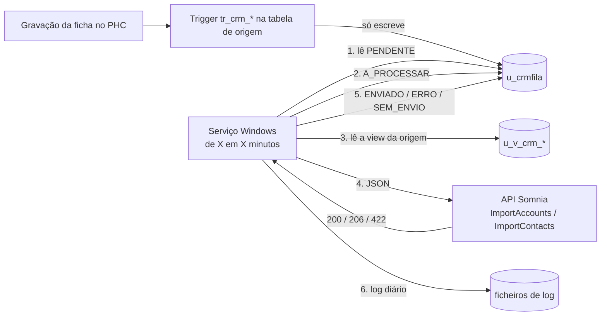
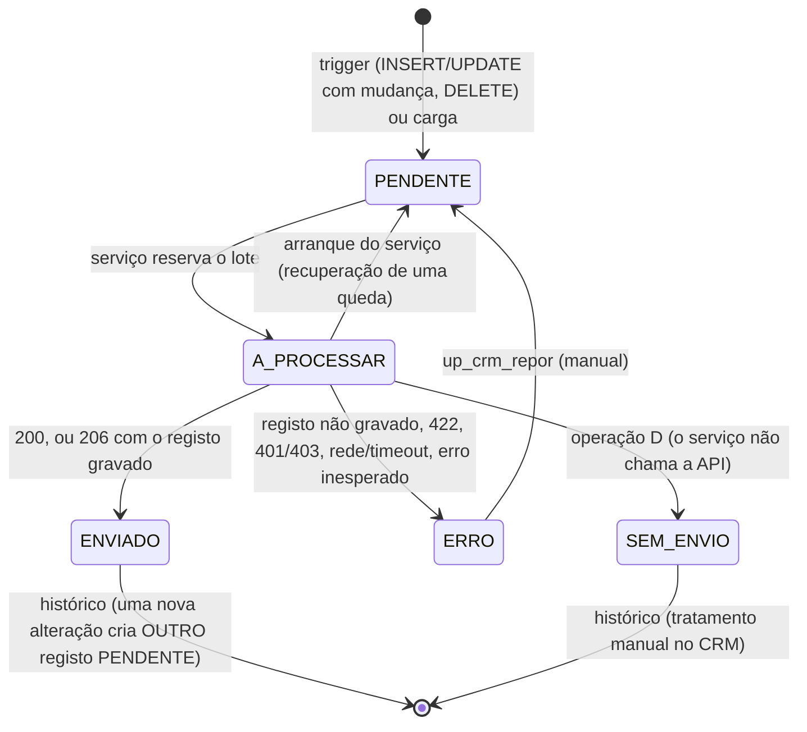

# Arquitetura — Integração PHC → Somnia CRM

> Estado: **implementada e testada na LAND2_DEMO** (SQL e .NET). Por validar: a ligação ao CRM real (ver
> [pendencias.md](pendencias.md), ponto P1) e a gravação de fichas pelo próprio PHC (ver
> [plano-de-testes.md](plano-de-testes.md), secção 6).

## 1. Circuito

Ordem de cada ciclo: **primeiro todas as contas, depois os contactos**. Um contacto cuja conta esteja
PENDENTE, A_PROCESSAR ou em ERRO na fila fica para o ciclo seguinte.

## 2. Componentes

| Componente | Onde | Responsabilidade |
|---|---|---|
| Triggers `tr_crm_*` | `base-dados/04_triggers/` | Escrever na fila em INSERT/UPDATE/DELETE. Sem lógica pesada nem chamadas externas. Nunca bloqueiam a gravação do PHC. |
| `u_crmfila` | `base-dados/01_tabelas/` | Fila e histórico completo. Nunca é limpa automaticamente. |
| `up_crm_enfileirar` | `base-dados/03_procedimentos/` | **Único ponto de escrita na fila**: deduplicação, substituição por eliminação e geração do stamp. Usado pelos triggers e pela carga. |
| Views `u_v_crm_*` | `base-dados/02_views/` | Colunas já com os nomes da API, trim e `obs` em varchar(max). |
| Procedimentos | `base-dados/03_procedimentos/` | Carga (origem + número opcional), reposição, consultas. |
| Core | `servico/src/…Core/` | Estados, ordem, truncagem, interpretação de 200/206/422, orquestrador do ciclo. Sem SQL, HTTP nem PHC. |
| Infrastructure | `servico/src/…Infrastructure/` | Fila e views (SQL), cliente da API (HTTP), log em ficheiro, applock, DPAPI. |
| Worker | `servico/src/…Worker/` | Windows Service, injeção de dependências, `appsettings.json` sem segredos. |

Dependências só num sentido: Worker → Infrastructure → Core. O Core não referencia nenhum outro projeto.

## 3. Tabela de fila `u_crmfila`

Tabela de utilizador **criada no PHC** (nunca por SQL; o instalador só a verifica). Convenção (igual à `U_CLCONTACT`): prefixo `u_`, stamp `char(25)` como chave,
campos `ousr*` / `usr*`, colunas NOT NULL com default `''` ou `0`. Dicionário completo em
[dicionario-de-dados.md](dicionario-de-dados.md).

**Não guarda** o JSON enviado nem dados pessoais do registo (RGPD): só identificadores, estados e mensagens.

Índices: `in_u_crmfila_leitura (estado, datacriacao)` para a leitura do serviço;
`in_u_crmfila_dedup (entidade, stamporigem, estado)` para a deduplicação;
`in_u_crmfila_codigo (entidade, codigo)` para o histórico de um cliente.

**Formato do stamp** (replica o do PHC, ver 8.1-b): `CRM` + `yymmdd` + `hhmmss` + `,` + 8 dígitos
de uma sequência (`u_crmfila_seq`) = 24 caracteres num `char(25)`. A sequência garante unicidade sem colisões.

## 4. Estados e transições

Regras:
- **Deduplicação:** se já existir PENDENTE para a mesma `entidade` + `stamporigem`, não se cria outro. Uma
  eliminação (`D`) substitui uma alteração pendente do mesmo stamp; um `U` sobre um `D` pendente repõe-no como `U`.
- **Concorrência:** antes de chamar a API o serviço passa o lote a A_PROCESSAR. Uma alteração feita durante o
  envio cria um novo PENDENTE e não se perde.
- **Recuperação:** ao obter o bloqueio de instância única, o serviço repõe a PENDENTE o que ficou em A_PROCESSAR.
- **Sem reprocessamento automático:** qualquer falha vai para ERRO. Só volta a PENDENTE por `up_crm_repor`.
- **Falha de rede, timeout ou 401/403:** o lote inteiro passa a ERRO e fica em destaque no log
  (`FALHA_REDE` / `FALHA_AUTENTICACAO`).
- **Mensagens:** um reenvio com sucesso mantém a mensagem do erro anterior (histórico da reposição).

## 5. Triggers

| Trigger | Tabela | Eventos | Notas |
|---|---|---|---|
| `tr_crm_cl` | CL | INSERT, UPDATE, DELETE | Todas as fichas (sede e estabelecimentos); cada uma gera conta `NO-ESTAB`. |
| `tr_crm_cl2` | CL2 | INSERT, UPDATE | Entidade `CONTA`, origem `CL2`. Só enfileira se a CL existir. |
| `tr_crm_u_clcontact` | U_CLCONTACT | INSERT, UPDATE, DELETE | Só contactos com ficha CL (órfãos ficam fora). |

- Comparam `inserted` com `deleted` (`EXCEPT` sobre os campos integrados, comparação **binária**: apanha mudanças
  só de maiúsculas ou acentos; espaços no fim não contam). Não usam `UPDATE(coluna)`, **com uma exceção**: a coluna
  `OBS` de `U_CLCONTACT` é `text` e o SQL Server não deixa lê-la em `inserted`/`deleted` num trigger AFTER; para ela
  usa-se `UPDATE(obs)` (pode gerar um reenvio a mais, inofensivo, porque o CRM faz upsert).
- Tratam conjuntos (`inserted`/`deleted`), nunca variáveis escalares. `SET NOCOUNT ON`. `SET XACT_ABORT OFF`.
- **Nunca impedem a gravação do PHC**: todo o corpo está em `TRY…CATCH` com `CATCH` vazio, e a escrita na fila usa
  a cadeia de propriedade (o utilizador do PHC não precisa de direitos sobre a fila). Testado: com a fila
  indisponível a gravação continua a funcionar e a transação fica utilizável (`XACT_STATE = 1`, mesmo com
  `XACT_ABORT ON`).
- Alterações de saldo (`esaldo`) ou de campos não integrados **não** geram fila.
- **Não tocam nos triggers do PHC** (`tr_cl_update`, `tr_cl_delete`), que estão cifrados e por isso ilegíveis.

## 6. Views

- `u_v_crm_conta_cl`: `cl` LEFT JOIN `cl2` (`cl2.cl2stamp = cl.clstamp`), `ISNULL(descpais, '')`.
  `code` = `cl.no + '-' + cl.estab` (ex.: `13444-0`). Sem filtro de estabelecimento.
- `u_v_crm_contacto_cl`: `u_clcontact` INNER JOIN `cl` por `clstamp`.
  `accountCode` = `cl.no + '-' + cl.estab` da ficha ligada (o `estab` do próprio contacto é ignorado).
  Colunas de ligação: `stamp` (à fila) e `accountStamp` (à conta, para a regra de espera).

Colunas com os nomes exatos da API; os campos fora do âmbito (`obsCreation`, `obsExclusion`, `currentBalance`,
`earliestDueDate`) não existem nas views e por isso nunca são enviados.

## 7. Serviço

- .NET 8, Worker Service como Windows Service (`SigmaCode.Landeiro.CrmSync`).
- **Instância única**: applock de sessão (`sp_getapplock`) numa ligação dedicada, mantida durante a vida do
  serviço. Uma segunda instância fica em `SEM_BLOQUEIO` e não processa nada (testado).
- `appsettings.json` (sem segredos): intervalo (5 min), tamanho do lote (100), retenção de logs (7 dias),
  limites de campos (vazio = sem truncagem), origens (origem / entidade / view / endpoint / accountType),
  URL base. Configurável também por variáveis de ambiente (`CrmSync__Chave`).
- **Credenciais** fora do código, do repositório e do appsettings: variáveis de ambiente
  (`CRMSYNC_DB_CONNECTION`, `CRMSYNC_API_TOKEN`) ou ficheiro protegido por **DPAPI** (âmbito da máquina), criado por
  `deploy/guardar-credenciais.ps1`. Justificação do DPAPI: nativo do Windows, sem chaves para gerir, e o ficheiro
  copiado para outro servidor não abre.
- Truncagem no serviço, com aviso no log (entidade, stamp e campo; nunca o valor).
- **Log diário** (`crmsync-AAAAMMDD.log`): data/hora, nível, origem, entidade, código, stamp, resultado, ação/id,
  mensagem. Só os logs com mais de N dias são apagados (a fila nunca).
- Dependências NuGet: `Microsoft.Data.SqlClient` (provider oficial; o `System.Data.SqlClient` está descontinuado),
  `System.Security.Cryptography.ProtectedData` (DPAPI não faz parte do .NET 8 base),
  `Microsoft.Extensions.Hosting.WindowsServices` (host de Windows Service). Nos testes: xunit.

## 8. Pontos que ficam em aberto

Ver [pendencias.md](pendencias.md). Os principais:

1. **P1: o endpoint da API não responde com autenticação** (301 → página de login a qualquer pedido). Bloqueia a
   validação com o CRM real.
2. Pendências para a Orcinus (12 questões, ver [email-orcinus.md](email-orcinus.md)).
3. A gravação de fichas pelo próprio PHC (não só por SQL) tem de ser testada por quem tenha acesso ao PHC.
4. A password do `sa` usada no serviço tem de ser trocada antes de produção.

### 8.1 Resultados das verificações antes de criar objetos (LAND2_DEMO)

Feitas em 2026-10-13, só com leituras de catálogo, antes de criar qualquer objeto.

**a) Base de dados.** `SELECT DB_NAME()` = `LAND2_DEMO` (SQL Server 2019, compatibilidade 150, colação
`SQL_Latin1_General_CP1_CI_AI`, dono `sa`). Os scripts de instalação e de rollback recusam outra base
(`BaseDados`) e recusam a `LAND2` sem `-v PermitirProducao=SIM`.

**b) Formato dos stamps.** Lido de `clstamp` (14 032), `u_clcontactstamp` e `cl2stamp`:
`DATALENGTH` = 25 (`char(25)`), `LEN` = 23 ou 24 (o PHC deixa 1 espaço no fim), **sem `COLUMN_DEFAULT`** (`('')`) e sem
função de stamp em `sys.objects`. Estrutura: prefixo de 3 caracteres que varia (`JUC`, `CLA`, `Adm`, `ANG`,
`FIL`, `CC2`, `PC0`…; o PHC não o documenta aqui, não se assume o seu significado) + data/hora numérica + `,` + dígitos (ex.: `FIL26091153534,171313351`). Replicado como
`CRM` + `yymmdd` + `hhmmss` + `,` + 8 dígitos (24 caracteres).

**c) Nomes físicos e tipos** (confirmados contra a especificação):

| Coluna | Tipo real | Nota |
|---|---|---|
| `cl.clstamp` | char(25) | |
| `cl.no` | numeric(10,0) | |
| `cl.estab` | numeric(3,0) | |
| `cl.nome` / `morada` / `local` / `codpost` | varchar(55) / (55) / (43) / (45) | |
| `cl.ncont` / `telefone` / `tlmvl` / `email` / `fax` | varchar(20) / (60) / (45) / (100) / (60) | |
| `cl2.cl2stamp` | char(25) | |
| `cl2.descpais` | varchar(55) | |
| `u_clcontact.u_clcontactstamp` / `clstamp` | char(25) | |
| `u_clcontact.nome` / `funcao` / `tipo` / `telefone` / `tlmvl` / `email` | varchar(55) / (15) / (25) / (60) / (60) / (60) | |
| `u_clcontact.estab` / `no` | numeric(3,0) / numeric(10,0) | |

- `cl2` tem **uma linha por cliente** (0 `cl2stamp` repetidos); **0** CL sem CL2; **1 CL2 órfã** (sem CL).
- **Divergência entre a DEMO e a LAND2:** a `u_clcontact` da DEMO **não tem** `obs` (`text`) nem `departamento`
  (`varchar(100)`), que existem na LAND2 e na especificação. Foram acrescentados à DEMO por
  `base-dados/testes/00_preparar_demo_u_clcontact.sql` (só DEMO), com o mesmo tipo e default da LAND2.
- `u_clcontact.nome` é o nome da pessoa: `contacto` está vazio em 10 831 de 11 234 registos; `nome` está vazio em 369.

**d) Triggers existentes** (`sys.triggers` + `sys.trigger_events`): `tr_cl_update` (UPDATE) e `tr_cl_delete`
(DELETE), ambos na `cl`, ativos, **cifrados** (`OBJECTPROPERTY(IsEncrypted) = 1`, definição NULL). Não há triggers em
`cl2` nem em `u_clcontact`. **Limitação registada:** não se consegue ler o que os triggers cifrados fazem; foram
deixados intactos e os testes mostram que coexistem com os `tr_crm_*` (os `UPDATE`/`DELETE` dos testes disparam-nos).

**e) Contactos.** Na DEMO: 60 contactos têm `u_clcontact.estab` diferente do `cl.estab` da ficha ligada por `clstamp`
(de 11 233 com ficha; 57 deles são contactos com `estab = 0` ligados a uma ficha de estabelecimento); 1 contacto órfão
(sem ficha). Na LAND2 (só leitura): 61 de 11 239. **Não é bloqueio**: a regra decidida é ligar pelo `clstamp`
e ignorar o `estab` do contacto. A view de contactos e os testes implementam-no.

**f) .NET.** SDKs instalados: 9.0.318, 10.0.103, 10.0.401. Runtimes: `Microsoft.NETCore.App` 8.0.31, 9.0.20, 10.0.3,
10.0.12. Usa-se o SDK instalado com `TargetFramework net8.0` (**não foi preciso instalar o SDK 8**). **Servidor do
cliente:** precisa do runtime **`Microsoft.NETCore.App` 8.x** (ou publicar com `-AutoContido`, que leva o runtime junto).

## 9. Decisões já tomadas (do prompt)

- Âmbito: só clientes e contactos nesta fase. Circuito genérico para FL e PE.
- Eliminações: a API não as suporta; o serviço envia o registo apagado como `Inativo` só com os códigos. Nunca enviado
  (ou contacto sem código da conta) = `SEM_ENVIO` + log.
- Carga: 1 a 1 (cliente 13444 primeiro); importação completa depois.
- Retenção: só logs (7 dias por defeito). A fila guarda tudo. Erros: só reposição manual.
- `code` da conta = `NO-ESTAB` (ex.: `13444-0`), para sede **e** estabelecimentos. Cada estabelecimento é uma conta própria.
- `contactCode` = `u_clcontactstamp`; `accountType` fixo por origem. Contactos ligados pelo `clstamp`.
- `obsCreation`, `obsExclusion`, `currentBalance`, `earliestDueDate` **não** são enviados nesta fase.
- Base de testes: `LAND2_DEMO`. Nunca escrever na `LAND2` (real) sem confirmação escrita.
- Triggers novos com o prefixo `tr_crm_`; os existentes não se alteram, desativam, reordenam nem apagam.
