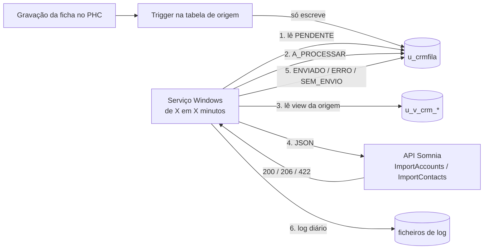
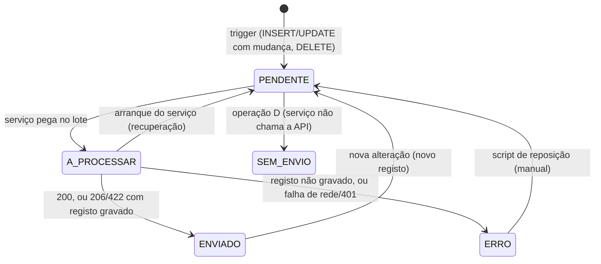

# Arquitetura — Integração PHC → Somnia CRM

> **Estado: RASCUNHO para validação.** Ainda não há código. Os nomes físicos de colunas PHC marcados
> "A confirmar" dependem de acesso à base de dados do cliente (ver secção 8).

## 1. Circuito

Ordem de cada ciclo: **primeiro todas as contas, depois os contactos**. Um contacto cuja conta esteja
PENDENTE ou em ERRO fica para o ciclo seguinte.

## 2. Componentes

| Componente | Onde | Responsabilidade |
|---|---|---|
| Triggers | `base-dados/04_triggers/` | Escrever na fila em INSERT/UPDATE/DELETE. Sem lógica pesada. |
| `u_crmfila` | `base-dados/01_tabelas/` | Fila e histórico completo. Nunca é limpa automaticamente. |
| Views `u_v_crm_*` | `base-dados/02_views/` | Colunas já com os nomes da API, trim e `obs` em varchar(max). |
| Procedimentos | `base-dados/03_procedimentos/` | Carga (origem + número opcional), reposição, consultas. |
| Core | `servico/src/…Core/` | Estados, regras de ordem, truncagem, interpretação de 200/206/422. Sem SQL, HTTP nem PHC. |
| Infrastructure | `servico/src/…Infrastructure/` | Acesso à fila e às views, cliente HTTP da API, log em ficheiro, DPAPI. |
| Worker | `servico/src/…Worker/` | Windows Service, injeção de dependências, `appsettings.json` sem segredos. |

Dependências só num sentido: Worker → Infrastructure → Core.

## 3. Tabela de fila `u_crmfila` (proposta)

Convenção das tabelas de utilizador (igual à `U_CLCONTACT`): prefixo `u_`, `stamp char(25)` como chave,
campos `ousr*` / `usr*`, colunas NOT NULL com default `''` ou `0`.

| Coluna | Tipo | Notas |
|---|---|---|
| `u_crmfilastamp` | char(25) | PK. Gerado no trigger. |
| `origem` | varchar(30) | Tabela de origem: `CL`, `CL2`, `U_CLCONTACT` (no futuro `FL`, `PE`). Obrigatório no insert. |
| `entidade` | varchar(10) | `CONTA` ou `CONTACTO`. |
| `tipoconta` | char(3) | `CLI` / `FOR` / `COL`. Vazio em contactos. |
| `stamporigem` | char(25) | Stamp do registo de origem. Para CL2, o `clstamp`. |
| `codigo` | varchar(60) | `cl.no` ou `contactCode`. Gravado no insert, para sobreviver a eliminações. |
| `operacao` | char(1) | `U` (upsert) ou `D` (eliminação). |
| `estado` | varchar(15) | `PENDENTE`, `A_PROCESSAR`, `ENVIADO`, `ERRO`, `SEM_ENVIO`. |
| `tentativas` | int | Informativo. |
| `ultimamensagem` | varchar(500) | Mensagem de erro (sem dados pessoais completos). |
| `idcrm` | varchar(60) | Id devolvido pelo CRM. |
| `acaocrm` | varchar(20) | `Updated`, `Inserted`, … conforme devolvido. |
| `lote` | varchar(36) | Identificador do lote de envio (GUID). |
| `datacriacao` / `dataenvio` | datetime | Datas de criação e de envio. |
| `ousrinis`, `ousrdata`, `ousrhora`, `usrinis`, `usrdata`, `usrhora` | auditoria | Convenção PHC. |

**Não guarda** o JSON enviado nem dados pessoais do registo (RGPD).

Índices: `(estado, datacriacao)` para a leitura do serviço; `(entidade, stamporigem, estado)` para a deduplicação.

## 4. Estados e transições

Regras:
- **Deduplicação:** se já existir PENDENTE para a mesma `entidade` + `stamporigem`, não se cria outro.
  Uma eliminação (`D`) substitui uma alteração pendente do mesmo stamp.
- **Concorrência:** a alteração feita durante o envio cria um novo PENDENTE. Não se perde.
- **Sem reprocessamento automático:** qualquer falha vai para ERRO. Só volta a PENDENTE por reposição manual.
- **Falha de rede ou 401:** o lote inteiro passa a ERRO e fica em destaque no log.

## 5. Triggers

| Tabela | Eventos | Notas |
|---|---|---|
| CL | INSERT, UPDATE, DELETE | Só `estab = 0`. Compara `inserted` com `deleted` (não usa `UPDATE(coluna)`). |
| CL2 | INSERT, UPDATE | Regista entidade `CONTA` com origem `CL2`. A deduplicação evita envio a dobrar. |
| U_CLCONTACT | INSERT, UPDATE, DELETE | Compara apenas os campos integrados. |

- Tratam conjuntos (`inserted`/`deleted`), nunca variáveis escalares.
- `SET NOCOUNT ON`. Sem chamadas externas.
- Alterações de saldo (`esaldo`) ou de campos não integrados **não** geram fila.

## 6. Views (proposta)

- `u_v_crm_conta_cl`: `cl` LEFT JOIN `cl2` (`cl2.cl2stamp = cl.clstamp`), `ISNULL(descpais, '')`, `estab = 0`.
- `u_v_crm_contacto_cl`: `u_clcontact` com join a `cl` por `clstamp` para obter `accountCode = cl.no`.

Colunas com os nomes exatos da API, mais o stamp de ligação à fila.

## 7. Serviço

- .NET 8, Worker Service como Windows Service.
- Instância única com `sp_getapplock`.
- `appsettings.json`: intervalo (por defeito 5 min), tamanho do lote, retenção de logs (7 dias), limites de campos (vazio = sem truncagem), origens (origem / entidade / view / endpoint / accountType), URL base.
- Credenciais da API e da base de dados fora do código: DPAPI (proposta; a confirmar).
- Truncagem feita no serviço, com aviso no log (entidade, stamp, campo; sem o valor completo).
- Log diário com data/hora, origem, entidade, código, stamp, resultado, ação/id e mensagem. Nunca o token nem a connection string.

## 8. Pontos para validares

1. **Acesso à base de dados.** Preciso de uma base de dados de **teste** (cópia do PHC do cliente). Não quero testar triggers em produção. Confirmas que existe?
2. **Nomes físicos.** Confirmar na base de teste: `cl.no`, `cl.estab`, `cl2.descpais`, `u_clcontact.nome` vs `contacto`, e os triggers que já existem em CL, CL2 e U_CLCONTACT.
3. **País.** O DOCX de apoio diz `cl.pais`; o teu prompt diz `cl2.descpais`. Estou a seguir o **prompt** (`cl2.descpais`).
4. **Formato dos stamps.** Proposta: gerar com `NEWID()` convertido para char(25). Confirmar o formato usado pelo PHC.
5. **Ambiente .NET.** Só há SDKs 9 e 10 instalados nesta máquina. O projeto pede .NET 8: instalar o SDK 8 (ou confirmar que o runtime 8 pode ser usado no servidor do cliente).
6. **Token.** O token está no PDF da API e fica só em `anexos/` (gitignored). Não vai para o código nem para a documentação. Recomendo trocá-lo (ver email).
7. **Conectividade.** Testar a partir do servidor PHC até `192.168.11.4` (VPN ou rede do cliente).

## 9. Decisões já tomadas (do prompt)

- Âmbito: só clientes e contactos nesta fase. Circuito genérico para FL e PE.
- Eliminações: `SEM_ENVIO` + log, porque a API não as suporta.
- Carga: 1 a 1 (cliente 13444 primeiro); importação completa depois.
- Retenção: só logs (7 dias por defeito). A fila guarda tudo.
- `code` = `cl.no` (só `estab = 0`); `contactCode` = `u_clcontactstamp`; `accountType` fixo por origem.
- `obsCreation`, `obsExclusion`, `currentBalance`, `earliestDueDate` **não** são enviados nesta fase.
